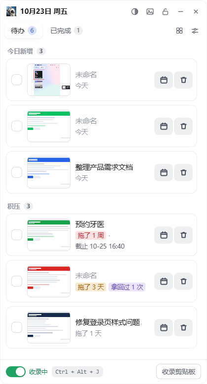
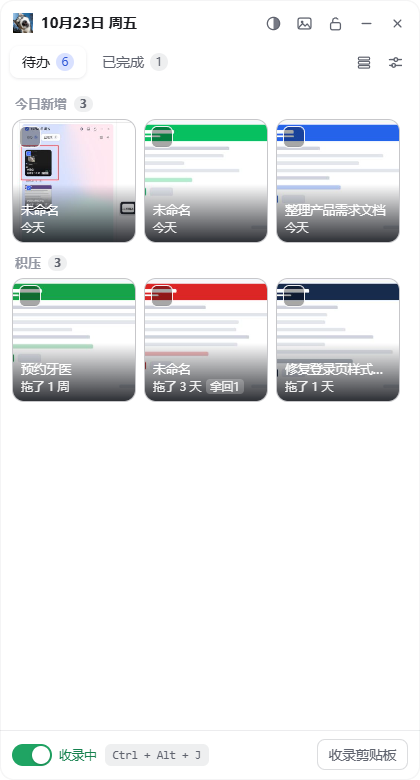
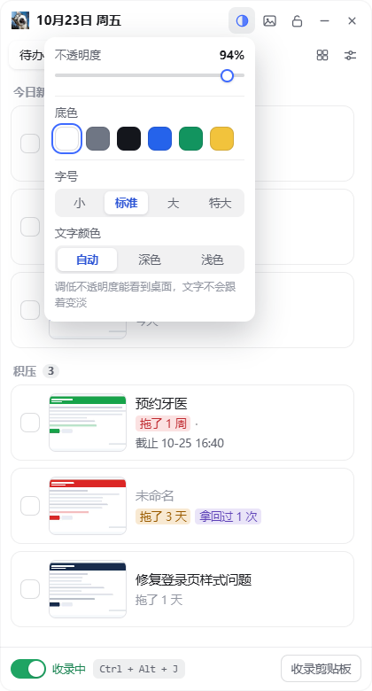
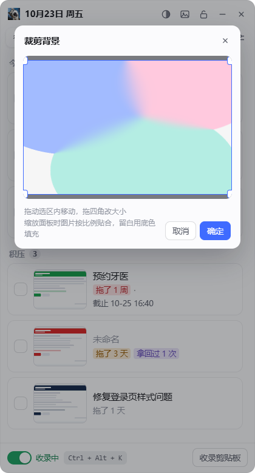
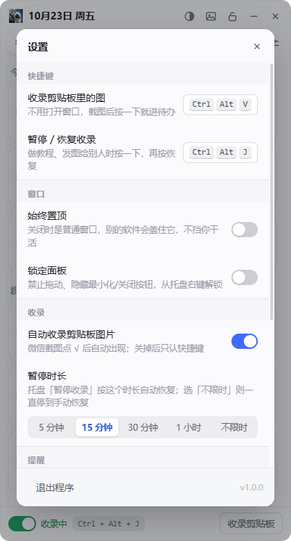
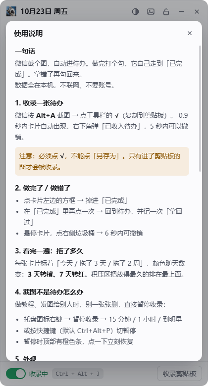
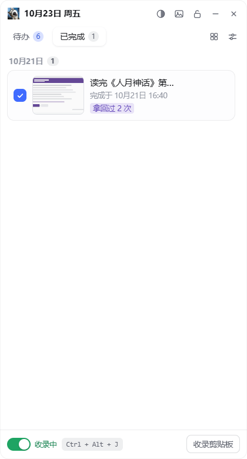

# 截图待办

微信截个图，自动进待办。做完打个勾，它自己走到「已完成」。拿错了再勾回来。

Windows 10 / 11 x64 · 纯本地 · 零联网 · 零账号 · 可调透明度 / 换壁纸 / 列表宫格 / 自定义全局快捷键

---

## 怎么用

1. **收录**：微信按 `Alt+A` 截图，点工具栏的 **√**（复制到剪贴板）。
   0.9 秒内卡片自动出现在「今日新增」，右下角弹一条「已收入待办」，5 秒内可点撤销。
2. **回顾**：每天早上 **8:30** 收一条系统通知：`7 条待处理，最早一条压了 4 天`。点通知打开窗口。
3. **完成**：点卡片左边的方框 → 掉进「已完成」。
4. **拿回**：在「已完成」里再点一次方框 → 回到待办，并记一次「拿回过」。
5. **删掉**：鼠标移到卡片上，点右侧垃圾桶 → 6 秒内可撤销。

> 关键：微信截图必须点 **√**，不能点「另存为」。只有进剪贴板的图才会被收录。

## 界面

| 待办（列表） | 宫格 | 外观弹层 |
|---|---|---|
|  |  |  |

| 背景裁剪 | 设置 | 使用说明 |
|---|---|---|---|
|  |  |  |

| 已完成 | 收录提示 |
|---|---|
|  |  |

- 左上角显示当天日期；右边一排：透明度/底色、背景、锁定、最小化、关闭
- 标签行右侧：**列表 / 宫格切换** + 设置
- **今日新增**：今天收的，新的在最上面
- **积压**：今天以前的，**放得最久的排最上面**
- 放置天数自动变色：0–2 天灰、3–6 天橙、≥7 天红
- 双击标题可改（选填，不填就显示「未命名」）；点缩略图看大图，`Esc` 关闭
- 悬停卡片右侧：日历图标设截止时间（选填，不发提醒）、垃圾桶删除
- 底部：**收录开关（绿=收录中 / 红=已停止）**，右边是切换用的快捷键
- **窗口可以随意拉伸**，最小 320×360
- 设置里有 **使用说明**（内嵌完整文档，见上图第三张）

## 外观

标题栏第一个按钮（半圆图标）：

- **不透明度 10%–100%**：调低能看见桌面，**文字不会跟着变淡**
- **底色**：白 / 灰 / 黑 / 蓝 / 绿 / 黄 六种。
  选深色（灰、黑、蓝、绿）时文字自动转浅色、卡片转半透明白

标题栏第二个按钮（图片图标）：

- **选择图片并裁剪**：可以拖选框只留一块，四角拖动改大小
- **图片铺法**：
  - `完整（留底色）`：图片按原比例完整显示，填不满的地方露出底色
  - `铺满（裁边）`：图片拉满整个面板，超出部分裁掉
- **背景遮罩 0–90%**：图片太花就调高，文字更清楚
- **清除背景图**

标题栏第三个按钮（锁）：**锁定面板**。锁定后拖动失效、最小化/关闭按钮隐藏，只能从托盘右键解锁。

## 快捷键

默认两个全局快捷键，**不打开窗口也能用**：

| 快捷键 | 作用 |
|---|---|
| `Ctrl+Alt+V` | 把剪贴板里最新的图收录进待办 |
| `Ctrl+Alt+J` | 开启 / 停止收录（等同底部的滑动开关） |

设置里点快捷键框就能重新录制。规则：**必须含 Ctrl/Alt/Shift/Win 之一，总共 2~3 个键**。
录入时会实时检测占用，被别的程序占了会当场提示；设置页也会标红「未生效」。

> 为什么不是更顺手的 P / X：这台机器上 `Ctrl+Alt+P` 和 `Ctrl+Alt+X` 都被别的程序占了，实测注册不上。
> 程序启动时会检测：**如果出厂默认键被占用，会自动换成可用的候选键并写回设置**，绝不会出现"装好就是坏的"。
> 你在设置里自己改的键如果被占用，程序不会擅自替换，只会标红提示。

## 不挡其他软件

**「始终置顶」默认关闭。** 关着就是普通窗口——别的软件会正常盖住它，不挡你干活；需要一直看着再去打开。

这样也照顾了动态壁纸（Wallpaper Engine 之类）：普通窗口不会触发它们「有窗口就暂停」的规则，壁纸照常播。

## 截图不是待办怎么办

做教程、发图给别人时连续截图，每张都会跑进待办。**别一张张删，直接暂停收录：**

- 托盘图标右键 → 暂停收录 → 15 分钟 / 1 小时 / 到明早
- 或窗口底部「暂停收录」按钮（15 分钟自动恢复）
- 暂停期间顶部会有一条橙色提示，点一下立刻恢复

比"猜这张图是不是待办"靠谱得多——程序判断不了你的意图，但你自己知道这一段时间在干什么。

## 设置项

| 项 | 说明 |
|---|---|
| 快捷键 | 收录 / 暂停两个组合键，可录制 |
| 始终置顶 | 钉在最前面，**默认关**（关掉不挡其他软件） |
| 锁定面板 | 防误拖，锁定后从托盘解锁 |
| 自动收录剪贴板图片 | 关掉后只能用「收录剪贴板」按钮手动收 |
| 每日提醒 | 改时间（默认 08:30）/ 开关。没有待办时不发通知 |
| 开机自启 | 登录后自动在托盘运行 |
| 数据目录 | 图片和数据库都在这里，整个目录拷走即可迁移 |
| 使用说明 | 内嵌完整文档 |

关闭窗口 = 收进托盘，热键和提醒仍然工作。退出请走托盘菜单「退出截图待办」。

## 数据在哪（重点）

**数据不在 exe 目录，在用户目录：**

```
%APPDATA%\截图待办\data\
├─ tasks.db          任务与状态流水（SQLite）
├─ images/<uuid>.jpg 主图，长边 ≤2560，JPEG q85
├─ thumbs/<uuid>.jpg 缩略图，宽 400
└─ background.jpg    自定义背景（如果设过）
```

**为什么放这儿**：以前放在 exe 同级，结果每次换版本、重新解压、覆盖安装，data 目录就被新包覆盖掉了。现在和 exe 完全分开，**随便换版本、删了 exe 重新解压，数据和截图都还在**。

老版本的数据会自动迁移：第一次运行新版本时，如果 exe 同级有 `data/` 而用户目录还没有，就整份复制过去，旧目录原样保留当备份。

备份 = 复制 `%APPDATA%\截图待办\data` 整个文件夹。
换电脑 = 把它放到新机器的同一位置即可。

100 条待办约占 30MB。

---

## 开发

```bash
npm install
npm run build      # 编译主进程(esbuild) + 渲染进程(vite)
npm start          # 构建并启动
npm run typecheck  # tsc --noEmit
npm run dist       # 构建并组装便携版 → release/截图待办-win32-x64/
```

打包**不用 electron-builder**：它要从 GitHub 拉 winCodeSign，国内基本拉不动（502）。
`scripts/pack.js` 直接复制 Electron 运行时 + 放入应用文件 + rcedit 写图标版本，全程离线。

调试辅助（仅开发模式）：

```bash
npm run build:electron
electron . --shot                       # 截图存到 shot.png 再退出
electron . --selftest                   # 自动跑勾选/拿回/连点/删除撤销
electron . --purge-test                 # 验证软删除到期后真的删文件
WDY_SHOT_TAB=done electron . --shot     # 截「已完成」
WDY_SHOT_GRID=1 electron . --shot       # 截宫格
WDY_SHOT_ALPHA=1 electron . --shot      # 截透明度弹层
WDY_SHOT_SETTINGS=1 electron . --shot   # 截设置
WDY_SHOT_CROP=1 electron . --shot       # 截背景裁剪器
WDY_SHOT_HOVER=1 electron . --shot      # 强制显示卡片悬停按钮
WDY_SHOT_SIZE=620x820 electron . --shot # 拉伸后截图
```

测试数据：

```bash
python scripts/make-fake-shots.py   # 生成假截图到 D:/tmp/fake
python scripts/make-bg.py           # 生成渐变壁纸
electron scripts/seed.js            # 灌进 data/（会清空现有数据）
```

### 技术栈

Electron 45 + React 19 + TypeScript + Vite 8 + esbuild，数据用 Electron 内置的 `node:sqlite`（无原生模块，换机器不需要 rebuild）。

### 几个容易踩的坑（已处理，改动时注意）

**1. Electron 45 的 `clipboard` 是 W3C 异步风格**，没有 `readImage()`：

```ts
const items = await clipboard.read()               // ClipboardItem[]
const mime = item.types.find(t => t.startsWith('image/'))
const blob = await item.getType(mime)              // Blob
const buf = Buffer.from(await blob.arrayBuffer())
```

**2. portable 版会被解压到临时目录运行。**
`app.getPath('exe')` 指向临时目录，数据会随进程消失。必须用 `PORTABLE_EXECUTABLE_DIR`（数据目录）和 `PORTABLE_EXECUTABLE_FILE`（真实 exe 路径）。

**3. 透明窗口的透明不能用 `win.setOpacity()`。**
那个 API 会把文字一起像素级变淡。正确做法：`transparent: true` 窗口 + CSS 变量 `--alpha` 只作用在背景层，内容层保持不透明。

**4. 深色底要配浅色字。**
`data-color` 决定面板底色（`--panel-rgb`），`data-scheme` 决定文字/卡片配色。新增底色时两处都要改。

**5. 删除是软删除。**
`tasks.deleted_at` 打标记，6 秒后物理删除并清理图片；撤销就是把标记清掉。别改成直接 DELETE。

**6. 背景图裁剪路径**
选图 → 主进程把图压到最长边 2000 存 `data/.bgpick.jpg` → 渲染进程裁剪 → 传原图坐标矩形 → 主进程 `nativeImage.crop()` 写 `background.jpg`。改这块注意坐标要按显示比例换算回像素。

### 状态流转必须包事务

```sql
UPDATE tasks SET status='done', completed_at=? WHERE id=? AND status='pending';
```

`AND status=?` 不能省，否则手快连点会写入重复事件、`reopen_count` 也会错。
自测里有一条「连点三次只产生一条 complete 事件」，改动这块务必重跑。
